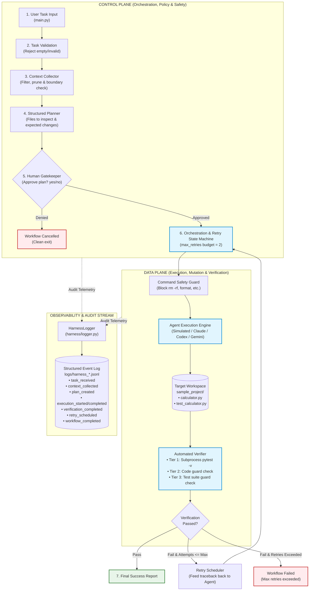

# AI Coding Harness: Architecture, Principles & Implementation

> A lightweight, modular implementation of an AI Coding Harness built for **Harness Engineering Fundamentals** (Lab 2).

---

## 1. What is an AI Coding Harness?

### The Core Problem: The "Naked" LLM
Modern Large Language Models (LLMs) and autonomous coding agents possess impressive code-generation capabilities, but using them in raw ("naked") prompt-only mode introduces critical software engineering risks:
- **No Grounding:** LLMs cannot observe local file trees, runtime environments, or system state on their own.
- **Hallucinations:** Models frequently invent non-existent APIs, files, and third-party dependencies.
- **Unbounded Blast Radius:** An autonomous agent given free shell access can run destructive commands (e.g., `rm -rf`, disk wipes, database drops) or mutate out-of-scope production code.
- **Self-Delusion:** Agents frequently proclaim *"I have fixed the bug and verified everything"* without having actually executed a test suite.

### The Harness Paradigm
An **AI Coding Harness** is the **deterministic outer shell** (the "Operating System") that wraps around a probabilistic AI model. Rather than treating AI code generation as an open-ended chatbot conversation, the harness operationalizes it as a **controlled, sandboxed, verifiable, and self-healing software engineering pipeline**:

```
+---------------------------------------------------------------------------------------------------+
|                                       THE AI CODING HARNESS                                       |
|                                                                                                   |
|  [ User Task ] ──> [ Context Collector ] ──> [ Planner ] ──> [ Human Gatekeeper ]                 |
|                            │                                         │                            |
|                            ▼                                         ▼                            |
|                   [ Workspace Sandbox ] <──────────── [ Agent Execution Engine ]                  |
|                            │                                                                      |
|                            ▼                                                                      |
|                  [ Objective Verifier ] ──(Pass)──> [ Verified Success / PR ]                     |
|                            │                                                                      |
|                         (Fail)                                                                    |
|                            ▼                                                                      |
|                 [ Self-Healing Retry Loop ] (Bounded attempt budget)                              |
+---------------------------------------------------------------------------------------------------+
```

The harness enforces:
1. **Separation of Concerns:** Strict isolation between the **Control Plane** (policy, planning, state, logging) and the **Data Plane** (code execution, file mutations, test runners).
2. **Objective Verification:** Zero trust in self-reporting; code changes are accepted **only** when external test runners and structural guards pass.
3. **Closed-Loop Feedback:** Test failures and traceback diagnostics are fed back into the agent to drive iterative self-correction.

---

## 2. System Architecture

The harness is organized into three primary layers: **Control Plane**, **Data Plane**, and **Observability**.



---

## 3. The 6 Core Engineering Principles & Our Implementation

Our implementation in `first-ai-harness` translates industrial agent harness principles into clean, modular Python components:

| # | Principle | Industry Concept | Our Implementation in `lab2/` |
|---|---|---|---|
| **1** | **Context Engineering & Grounding** | Don't flood the model with the entire drive; inject curated, relevant repository context within token budgets. | [`harness/context.py`](./harness/context.py): `collect_repository_context()` recursively inspects approved extensions (`.py`, `.md`, `.json`), automatically excludes `.venv` and `__pycache__`, and enforces a `12,000` character cap. |
| **2** | **Boundary Guards & Least Privilege** | Sandbox the agent so it cannot access parent folders or run destructive host commands. | [`harness/context.py`](./harness/context.py): `is_path_inside_repository()` prevents path traversal (`../outside.txt`).<br/>[`harness/executor.py`](./harness/executor.py): `is_command_safe()` intercepts destructive shell commands (`rm -rf`, `format`, `shutdown`). |
| **3** | **Structured Planning & Human Gatekeeper** | Separate *what* will be done from *doing* it; enforce a human checkpoint before disk writes. | [`harness/planner.py`](./harness/planner.py): `create_plan()` generates an `ExecutionPlan` dataclass.<br/>[`harness/orchestrator.py`](./harness/orchestrator.py): `request_human_approval()` displays the plan and requires explicit interactive confirmation (`yes`). |
| **4** | **Pluggable Agent Abstraction** | Decouple the workflow engine from the specific AI provider. | [`harness/executor.py`](./harness/executor.py): `execute_agent()` exposes a unified execution interface supporting **Simulated Agent mode** (offline zero-cost testing) and **External CLI mode** (Anthropic Claude Code, OpenAI Codex CLI, Google Gemini CLI) with process timeout guards. |
| **5** | **Multi-Tier Objective Verification** | Never ask the agent if the code works; test it objectively against behavioral and structural invariants. | [`harness/verifier.py`](./harness/verifier.py): `verify_changes()` runs **Tier 1** (subprocess execution of `pytest -v`), **Tier 2** (AST/code guard confirming `if b == 0: raise ValueError`), and **Tier 3** (verifying the presence of `test_divide_by_zero`). |
| **6** | **Closed-Loop Self-Healing & Telemetry** | Bounded retries with diagnostic feedback; structured event emission for forensic replay and monitoring. | [`harness/orchestrator.py`](./harness/orchestrator.py): `max_retries = 2` state machine triggers `retry_scheduled` on failure.<br/>[`harness/logger.py`](./harness/logger.py): `HarnessLogger` streams every lifecycle state to append-only `.jsonl` audit files. |

---

## 4. Execution Sequence Diagram

The interaction lifecycle between user input, the orchestrator, the agent, and the verification environment:

```mermaid
sequenceDiagram
    autonumber
    actor User as Engineer / User
    participant Main as main.py
    participant Orch as AIHarness (Orchestrator)
    participant Ctx as Context & Boundaries
    participant Plan as Planner
    participant Exec as Executor (Agent)
    participant Target as sample_project/
    participant Verif as Verifier (pytest)
    participant Log as Logger (JSONL)

    User->>Main: Run python main.py
    Main->>Orch: harness.run(task)
    Orch->>Log: event: task_received
    Orch->>Ctx: collect_repository_context()
    Ctx-->>Orch: Formatted repository context
    Orch->>Plan: create_plan(task, context)
    Plan-->>Orch: ExecutionPlan
    Orch->>User: request_human_approval(plan)
    User-->>Orch: Input: "yes"

    loop Attempt 1 .. max_retries + 1
        Orch->>Log: event: execution_started (attempt N)
        Orch->>Exec: execute_agent(task, project_path)
        Exec->>Target: Apply code & test patches
        Target-->>Exec: Modified calculator.py & test_calculator.py
        Exec-->>Orch: ExecutionResult (success/stdout/stderr)
        Orch->>Log: event: execution_completed

        Orch->>Verif: verify_changes(test_command="pytest -v")
        Verif->>Target: Run pytest subprocess & inspect source
        Target-->>Verif: Test results & code tokens
        Verif-->>Orch: VerificationResult (passed: bool, checks: list)
        Orch->>Log: event: verification_completed

        alt Verification PASSED
            Orch->>Log: event: workflow_completed (status: success)
            Orch-->>Main: Return True
            Main-->>User: "Harness completed successfully."
        else Verification FAILED & Attempts <= Max
            Orch->>Log: event: retry_scheduled (attempt + 1)
            Note over Orch,Exec: Feedback loop re-invokes agent with diagnostics
        else Max Retries Exceeded
            Orch->>Log: event: workflow_completed (status: failure)
            Orch-->>Main: Return False
            Main-->>User: "Harness failed."
        end
    end
```



---

## 5. Repository Structure

```text
lab2/
├── harness/                       # The Control Plane & Engine
│   ├── __init__.py
│   ├── config.py                  # HarnessConfig dataclass (timeout, retries, commands)
│   ├── context.py                 # Context collector & boundary guard (is_path_inside_repository)
│   ├── planner.py                 # Structured ExecutionPlan generator
│   ├── executor.py                # Command safety (is_command_safe) & agent runners
│   ├── verifier.py                # VerificationResult (pytest execution + guard checks)
│   ├── logger.py                  # Append-only JSONL event stream logger
│   └── orchestrator.py            # AIHarness state machine & request_human_approval
│
├── sample_project/                # The Data Plane / Target Repository
│   ├── calculator.py              # Math module (original vulnerability: unhandled divide by 0)
│   └── test_calculator.py         # Pytest suite
│
├── logs/                          # Forensic Audit Logs
│   └── harness_YYYYMMDD_HHMMSS.jsonl
│
├── main.py                        # Entrypoint script
├── requirements.txt               # Dependencies (pytest)
├── lab2.md                        # Complete lab curriculum document
├── harness_architecture.drawio    # Visual system architecture diagram
└── agent_harness_principles.drawio# Theoretical principles & simulation mapping diagram
```

---

## 6. Getting Started & Usage

### 1. Prerequisites
- Python 3.10+
- Git

### 2. Setup Virtual Environment
```bash
cd lab2
python -m venv .venv

# On macOS/Linux:
source .venv/bin/activate

# On Windows PowerShell:
.venv\Scripts\Activate.ps1

# Install requirements
pip install -r requirements.txt
```

### 3. Run Initial Baseline Tests
Before running the harness, confirm that the sample project passes baseline tests:
```bash
pytest sample_project -v
# Output: 3 passed
```

### 4. Execute the Harness
Run the harness entrypoint:
```bash
python main.py
```

1. The harness validates the task and extracts repository context.
2. It generates an `ExecutionPlan`.
3. **Human Gatekeeper Prompt:**
   ```text
   Proposed Plan
   objective: Update the divide function so division by zero raises a clear ValueError, and add a test for the behavior.
   files_to_inspect: ['calculator.py', 'test_calculator.py']
   expected_changes: ['Add explicit division-by-zero handling', 'Add a test for division by zero', 'Preserve existing calculator behavior']
   verification_steps: ['Run the complete test suite']

   Approve execution? Type yes to continue: yes
   ```
4. The executor runs, patches the source files, and verifies:
   ```text
   [task_received] ...
   [context_collected] ...
   [plan_created] ...
   [execution_started] ...
   [execution_completed] ...
   [verification_completed] ...
   [workflow_completed] ...

   Harness completed successfully.
   ```
5. Re-run tests to confirm 4 passed tests:
   ```bash
   pytest sample_project -v
   # Output: 4 passed
   ```

### 5. Inspecting Audit Logs
Inspect the latest JSON Lines log in `logs/`:
```bash
cat logs/harness_*.jsonl
```
Each line records an immutable state transition containing UTC timestamps, event tags, command stdout/stderr, and diagnostic checks.

---

## 7. Visual Architecture Diagrams (Draw.io)

For rich visual walkthroughs and presentations, open the accompanying `.drawio` files using the **VS Code Draw.io Integration** extension or [app.diagrams.net](https://app.diagrams.net):

1. **[harness_architecture.drawio](./harness_architecture.drawio):**
   - Detailed blueprint of Control Plane vs. Data Plane swimlanes.
   - Component interactions, safety guards, decision nodes, and telemetry routing.
2. **[agent_harness_principles.drawio](./agent_harness_principles.drawio):**
   - The paradigm shift from "Naked LLM" to Enterprise Harness.
   - Comprehensive side-by-side mapping between theoretical Harness Engineering principles and our Python simulation code.
   - Comparison matrix contrasting our lightweight educational implementation with industrial production harnesses (e.g., Google Antigravity, SWE-bench runners, Devin).
