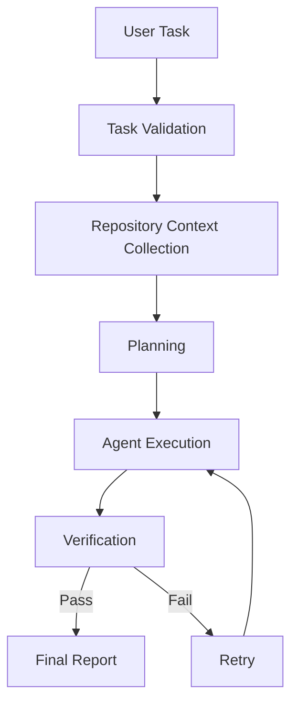

# Hands-On Lab 2: Build Your First AI Coding Harness

*Section 3 — Harness Engineering Fundamentals*

---

## Lab Overview

In this lab, you will build a lightweight AI coding harness that accepts a software task, creates an execution plan, gathers project context, runs a coding agent, verifies the results, retries when necessary, and records execution logs.

The goal is not to build a new large language model. Instead, you will build the surrounding system that controls how an AI coding agent operates.

Your harness will include:
- **User task input**
- **Project context collection**
- **Planning**
- **Agent instructions**
- **Controlled command execution**
- **Verification**
- **Retry logic**
- **Logging**
- **Final reporting**

This lab demonstrates the difference between simply sending a prompt to an AI model and placing that model inside a structured, repeatable engineering workflow.

### Lab Objectives
By the end of this lab, you will be able to:
- Explain the purpose of an AI harness.
- Build a simple harness around an AI coding agent.
- Separate the control plane from the execution environment.
- Collect repository context before execution.
- Define structured agent instructions.
- Execute and verify a software task.
- Add retry logic for failed verification.
- Record logs for observability and debugging.
- Apply safety controls to command execution.

### Estimated Completion Time
Approximately 90–120 minutes

### Prerequisites
Before starting this lab, you should have:
- Python 3.10 or later
- Git
- A code editor such as Visual Studio Code
- A terminal or command prompt
- One installed AI coding agent, such as Claude Code, Codex CLI, or Gemini CLI
- Basic familiarity with Python
- Basic familiarity with Git and terminal commands

> [!NOTE]
> You may complete the lab with only the simulated agent mode if you do not have access to an external AI coding tool.

---

## Part 1: Understand the Harness Architecture

Your harness will use the following execution flow:



The harness contains two major logical areas:

### Control Plane
The control plane decides:
- What task should be performed
- What context should be provided
- Which commands may run
- How many retries are allowed
- Whether verification passed
- When the workflow should stop

### Data Plane
The data plane performs the actual work:
- Reads files
- Executes the coding agent
- Runs terminal commands
- Runs tests
- Collects outputs
- Returns results to the control plane

In this lab, both areas will exist inside one Python project, but they will be separated into different modules.

---

## Part 2: Create the Lab Project

### Step 1: Create the Project Directory
Open your terminal and run:

```bash
mkdir first-ai-harness
cd first-ai-harness
```

Create a Python virtual environment:

```bash
python -m venv .venv
```

Activate it:

- **Windows PowerShell**:
  ```powershell
  .venv\Scripts\Activate.ps1
  ```
- **Windows Command Prompt**:
  ```cmd
  .venv\Scripts\activate
  ```
- **macOS or Linux**:
  ```bash
  source .venv/bin/activate
  ```

### Step 2: Create the Project Structure
Create the following folders and files:

```text
first-ai-harness/
│
├── harness/
│   ├── __init__.py
│   ├── config.py
│   ├── context.py
│   ├── planner.py
│   ├── executor.py
│   ├── verifier.py
│   ├── logger.py
│   └── orchestrator.py
│
├── sample_project/
│   ├── calculator.py
│   └── test_calculator.py
│
├── logs/
├── main.py
├── requirements.txt
└── README.md
```

#### macOS, Linux, or Git Bash
```bash
mkdir -p harness sample_project logs
touch harness/__init__.py
touch harness/config.py
touch harness/context.py
touch harness/planner.py
touch harness/executor.py
touch harness/verifier.py
touch harness/logger.py
touch harness/orchestrator.py
touch sample_project/calculator.py
touch sample_project/test_calculator.py
touch main.py requirements.txt README.md
```

#### Windows PowerShell
```powershell
New-Item -ItemType Directory harness
New-Item -ItemType Directory sample_project
New-Item -ItemType Directory logs
 
New-Item harness\__init__.py
New-Item harness\config.py
New-Item harness\context.py
New-Item harness\planner.py
New-Item harness\executor.py
New-Item harness\verifier.py
New-Item harness\logger.py
New-Item harness\orchestrator.py
New-Item sample_project\calculator.py
New-Item sample_project\test_calculator.py
New-Item main.py
New-Item requirements.txt
New-Item README.md
```

---

## Part 3: Build the Sample Software Project

The harness needs a small repository on which it can operate.

### Step 3: Create the Calculator Module
Add the following code to `sample_project/calculator.py`:

```python
def add(a: float, b: float) -> float:
    return a + b
 
 
def subtract(a: float, b: float) -> float:
    return a - b
 
 
def divide(a: float, b: float) -> float:
    return a / b
```

> [!NOTE]
> The `divide` function currently allows division by zero, which causes a runtime error.

### Step 4: Create the Initial Tests
Add the following code to `sample_project/test_calculator.py`:

```python
import pytest
 
from calculator import add, divide, subtract
 
 
def test_add() -> None:
    assert add(2, 3) == 5
 
 
def test_subtract() -> None:
    assert subtract(8, 3) == 5
 
 
def test_divide() -> None:
    assert divide(10, 2) == 5
```

### Step 5: Add the Requirements
Add the following line to `requirements.txt`:

```text
pytest
```

Install the dependency:

```bash
pip install -r requirements.txt
```

### Step 6: Run the Initial Tests
Move into the sample project:

```bash
cd sample_project
pytest -v
cd ..
```

Expected result:
```text
3 passed
```

The tests pass because division by zero is not yet covered.

---

## Part 4: Create the Harness Configuration

### Step 7: Define Harness Settings
Add the following code to `harness/config.py`:

```python
from dataclasses import dataclass
from pathlib import Path
 
 
@dataclass(frozen=True)
class HarnessConfig:
    project_path: Path
    log_directory: Path
    max_retries: int = 2
    timeout_seconds: int = 120
    agent_command: str = "simulate"
    test_command: tuple[str, ...] = ("pytest", "-v")
```

This configuration object defines:
- The target repository
- The logging location
- The maximum retry count
- The command timeout
- The agent implementation
- The verification command

Using a configuration object keeps workflow settings separate from the execution logic.

---

## Part 5: Build the Logging System

### Step 8: Create the Logger
Add the following code to `harness/logger.py`:

```python
import json
from datetime import datetime, timezone
from pathlib import Path
from typing import Any
 
 
class HarnessLogger:
    def __init__(self, log_directory: Path) -> None:
        self.log_directory = log_directory
        self.log_directory.mkdir(parents=True, exist_ok=True)
 
        timestamp = datetime.now(timezone.utc).strftime("%Y%m%d_%H%M%S")
        self.log_file = self.log_directory / f"harness_{timestamp}.jsonl"
 
    def log(self, event: str, data: dict[str, Any]) -> None:
        record = {
            "timestamp": datetime.now(timezone.utc).isoformat(),
            "event": event,
            "data": data,
        }
 
        with self.log_file.open("a", encoding="utf-8") as file:
            file.write(json.dumps(record) + "\n")
 
        print(f"[{event}] {data}")
```

The logger writes each event as one JSON object per line.

Example output:
```json
{
  "timestamp": "2026-07-13T15:00:00+00:00",
  "event": "task_received",
  "data": {
    "task": "Handle division by zero"
  }
}
```

This format is useful for:
- Debugging
- Replay
- Metrics
- Auditing
- Observability

---

## Part 6: Build Repository Context Collection

### Step 9: Create the Context Collector
Add the following code to `harness/context.py`:

```python
from pathlib import Path
 
 
ALLOWED_EXTENSIONS = {
    ".py",
    ".md",
    ".txt",
    ".json",
    ".toml",
    ".yaml",
    ".yml",
}
 
 
def collect_repository_context(
    project_path: Path,
    max_characters: int = 12_000,
) -> str:
    sections: list[str] = []
    current_size = 0
 
    for path in sorted(project_path.rglob("*")):
        if not path.is_file():
            continue
 
        if path.suffix not in ALLOWED_EXTENSIONS:
            continue
 
        if ".venv" in path.parts or "__pycache__" in path.parts:
            continue
 
        relative_path = path.relative_to(project_path)
 
        try:
            content = path.read_text(encoding="utf-8")
        except UnicodeDecodeError:
            continue
 
        section = (
            f"\n--- FILE: {relative_path} ---\n"
            f"{content}\n"
        )
 
        if current_size + len(section) > max_characters:
            break
 
        sections.append(section)
        current_size += len(section)
 
    return "".join(sections)
```

This module demonstrates basic context engineering.

The collector:
- Recursively searches the repository
- Reads only approved file types
- Skips virtual environments and cache folders
- Limits the amount of context
- Labels each file clearly

### Step 10: Test Context Collection
Temporarily add the following code to `main.py`:

```python
from pathlib import Path
 
from harness.context import collect_repository_context
 
 
project_path = Path("sample_project")
context = collect_repository_context(project_path)
 
print(context)
```

Run:
```bash
python main.py
```

You should see the contents of both sample project files.

After verifying the result, remove the temporary code from `main.py`.

---

## Part 7: Build the Planner

### Step 11: Create a Structured Plan
Add the following code to `harness/planner.py`:

```python
from dataclasses import dataclass
 
 
@dataclass
class ExecutionPlan:
    objective: str
    files_to_inspect: list[str]
    expected_changes: list[str]
    verification_steps: list[str]
 
 
def create_plan(task: str, repository_context: str) -> ExecutionPlan:
    context_lower = repository_context.lower()
    task_lower = task.lower()
 
    files_to_inspect: list[str] = []
    expected_changes: list[str] = []
    verification_steps: list[str] = ["Run the complete test suite"]
 
    if "divide" in task_lower or "division" in task_lower:
        if "calculator.py" in context_lower:
            files_to_inspect.append("calculator.py")
 
        if "test_calculator.py" in context_lower:
            files_to_inspect.append("test_calculator.py")
 
        expected_changes.extend(
            [
                "Add explicit division-by-zero handling",
                "Add a test for division by zero",
                "Preserve existing calculator behavior",
            ]
        )
 
    if not files_to_inspect:
        files_to_inspect.append("Inspect all relevant source files")
 
    if not expected_changes:
        expected_changes.append("Make the smallest safe change")
 
    return ExecutionPlan(
        objective=task,
        files_to_inspect=files_to_inspect,
        expected_changes=expected_changes,
        verification_steps=verification_steps,
    )
```

This planner uses deterministic logic rather than an AI model.

In a production harness, the planner could call a model, but deterministic planning is useful for learning because the process remains visible and predictable.

---

## Part 8: Build the Agent Executor

The executor will support two modes:
1. **Simulated agent mode**
2. **External coding-agent mode**

### Step 12: Add Command Safety Controls
Add the following code to `harness/executor.py`:

```python
import subprocess
from dataclasses import dataclass
from pathlib import Path
 
 
BLOCKED_COMMAND_PATTERNS = {
    "rm -rf",
    "format ",
    "shutdown",
    "reboot",
    "del /s",
    "drop database",
}
 
 
@dataclass
class ExecutionResult:
    success: bool
    stdout: str
    stderr: str
    return_code: int
 
 
def is_command_safe(command: str) -> bool:
    normalized = command.lower().strip()
 
    return not any(
        blocked_pattern in normalized
        for blocked_pattern in BLOCKED_COMMAND_PATTERNS
    )
 
 
def run_command(
    command: list[str],
    working_directory: Path,
    timeout_seconds: int,
) -> ExecutionResult:
    command_text = " ".join(command)
 
    if not is_command_safe(command_text):
        return ExecutionResult(
            success=False,
            stdout="",
            stderr=f"Blocked unsafe command: {command_text}",
            return_code=1,
        )
 
    try:
        completed = subprocess.run(
            command,
            cwd=working_directory,
            capture_output=True,
            text=True,
            timeout=timeout_seconds,
            check=False,
        )
 
        return ExecutionResult(
            success=completed.returncode == 0,
            stdout=completed.stdout,
            stderr=completed.stderr,
            return_code=completed.returncode,
        )
 
    except subprocess.TimeoutExpired as error:
        return ExecutionResult(
            success=False,
            stdout=error.stdout or "",
            stderr="Command timed out",
            return_code=124,
        )
```

This is a basic command safety layer. Production harnesses should use stronger controls, including:
- Container isolation
- Sandboxing
- Command allowlists
- Permission scopes
- Filesystem restrictions
- Human approval

### Step 13: Add the Simulated Coding Agent
Continue adding the following code to `harness/executor.py`:

```python
def simulate_agent_execution(project_path: Path, task: str) -> ExecutionResult:
    calculator_file = project_path / "calculator.py"
    test_file = project_path / "test_calculator.py"
 
    if "division" not in task.lower() and "divide" not in task.lower():
        return ExecutionResult(
            success=False,
            stdout="",
            stderr="The simulated agent only supports the division task.",
            return_code=1,
        )
 
    calculator_code = calculator_file.read_text(encoding="utf-8")
 
    old_function = """def divide(a: float, b: float) -> float:
    return a / b
"""
 
    new_function = """def divide(a: float, b: float) -> float:
    if b == 0:
        raise ValueError("Cannot divide by zero")
 
    return a / b
"""
 
    if old_function not in calculator_code:
        return ExecutionResult(
            success=False,
            stdout="",
            stderr="Expected divide function was not found.",
            return_code=1,
        )
 
    calculator_file.write_text(
        calculator_code.replace(old_function, new_function),
        encoding="utf-8",
    )
 
    test_code = test_file.read_text(encoding="utf-8")
 
    new_test = """
 
def test_divide_by_zero() -> None:
    with pytest.raises(ValueError, match="Cannot divide by zero"):
        divide(10, 0)
"""
 
    if "test_divide_by_zero" not in test_code:
        test_file.write_text(
            test_code + new_test,
            encoding="utf-8",
        )
 
    return ExecutionResult(
        success=True,
        stdout=(
            "Updated calculator.py with division-by-zero handling.\n"
            "Added a division-by-zero test."
        ),
        stderr="",
        return_code=0,
    )
```

This simulated agent performs a controlled code change. It is intentionally limited so students can observe the surrounding harness without needing an external AI account.

### Step 14: Add External Agent Support
Continue adding the following code to `harness/executor.py`:

```python
def run_external_agent(
    agent_command: str,
    project_path: Path,
    task: str,
    timeout_seconds: int,
) -> ExecutionResult:
    prompt = (
        "You are operating inside a controlled coding harness.\n\n"
        f"Task:\n{task}\n\n"
        "Requirements:\n"
        "- Make the smallest safe change.\n"
        "- Add or update tests.\n"
        "- Do not modify unrelated files.\n"
        "- Do not install new dependencies.\n"
        "- Do not run destructive commands.\n"
        "- Summarize the files changed.\n"
    )
 
    if agent_command == "claude":
        command = ["claude", "-p", prompt]
    elif agent_command == "codex":
        command = ["codex", "exec", prompt]
    elif agent_command == "gemini":
        command = ["gemini", "-p", prompt]
    else:
        return ExecutionResult(
            success=False,
            stdout="",
            stderr=f"Unsupported agent command: {agent_command}",
            return_code=1,
        )
 
    return run_command(
        command=command,
        working_directory=project_path,
        timeout_seconds=timeout_seconds,
    )
```

> [!TIP]
> Command-line options can change between tool versions. Verify the correct non-interactive command syntax for your installed agent before using external mode.

### Step 15: Create the Main Execution Function
Complete `harness/executor.py` with:

```python
def execute_agent(
    agent_command: str,
    project_path: Path,
    task: str,
    timeout_seconds: int,
) -> ExecutionResult:
    if agent_command == "simulate":
        return simulate_agent_execution(project_path, task)
 
    return run_external_agent(
        agent_command=agent_command,
        project_path=project_path,
        task=task,
        timeout_seconds=timeout_seconds,
    )
```

---

## Part 9: Build the Verification Layer

### Step 16: Create the Verifier
Add the following code to `harness/verifier.py`:

```python
from dataclasses import dataclass
from pathlib import Path
 
from harness.executor import ExecutionResult, run_command
 
 
@dataclass
class VerificationResult:
    passed: bool
    test_result: ExecutionResult
    checks: list[str]
 
 
def verify_changes(
    project_path: Path,
    test_command: tuple[str, ...],
    timeout_seconds: int,
) -> VerificationResult:
    checks: list[str] = []
 
    test_result = run_command(
        command=list(test_command),
        working_directory=project_path,
        timeout_seconds=timeout_seconds,
    )
 
    if test_result.success:
        checks.append("Test suite passed")
    else:
        checks.append("Test suite failed")
 
    calculator_file = project_path / "calculator.py"
    test_file = project_path / "test_calculator.py"
 
    calculator_content = calculator_file.read_text(encoding="utf-8")
    test_content = test_file.read_text(encoding="utf-8")
 
    has_zero_check = "if b == 0" in calculator_content
    has_new_test = "test_divide_by_zero" in test_content
 
    checks.append(
        "Division-by-zero guard found"
        if has_zero_check
        else "Division-by-zero guard missing"
    )
 
    checks.append(
        "Division-by-zero test found"
        if has_new_test
        else "Division-by-zero test missing"
    )
 
    passed = (
        test_result.success
        and has_zero_check
        and has_new_test
    )
 
    return VerificationResult(
        passed=passed,
        test_result=test_result,
        checks=checks,
    )
```

This verification layer checks both behavior and implementation evidence. A stronger production verifier might also run:
- Static analysis
- Type checking
- Security scanning
- Formatting checks
- Integration tests
- Code review agents
- Policy checks

---

## Part 10: Build the Orchestrator

### Step 17: Create the Harness Lifecycle
Add the following code to `harness/orchestrator.py`:

```python
from dataclasses import asdict
 
from harness.config import HarnessConfig
from harness.context import collect_repository_context
from harness.executor import execute_agent
from harness.logger import HarnessLogger
from harness.planner import create_plan
from harness.verifier import verify_changes
 
 
class AIHarness:
    def __init__(self, config: HarnessConfig) -> None:
        self.config = config
        self.logger = HarnessLogger(config.log_directory)
 
    def run(self, task: str) -> bool:
        self.logger.log(
            "task_received",
            {"task": task},
        )
 
        if not task.strip():
            self.logger.log(
                "task_rejected",
                {"reason": "Task cannot be empty"},
            )
            return False
 
        repository_context = collect_repository_context(
            self.config.project_path
        )
 
        self.logger.log(
            "context_collected",
            {
                "characters": len(repository_context),
                "project_path": str(self.config.project_path),
            },
        )
 
        plan = create_plan(task, repository_context)
 
        self.logger.log(
            "plan_created",
            asdict(plan),
        )
 
        for attempt in range(1, self.config.max_retries + 2):
            self.logger.log(
                "execution_started",
                {
                    "attempt": attempt,
                    "agent": self.config.agent_command,
                },
            )
 
            execution_result = execute_agent(
                agent_command=self.config.agent_command,
                project_path=self.config.project_path,
                task=task,
                timeout_seconds=self.config.timeout_seconds,
            )
 
            self.logger.log(
                "execution_completed",
                {
                    "attempt": attempt,
                    "success": execution_result.success,
                    "stdout": execution_result.stdout,
                    "stderr": execution_result.stderr,
                    "return_code": execution_result.return_code,
                },
            )
 
            verification_result = verify_changes(
                project_path=self.config.project_path,
                test_command=self.config.test_command,
                timeout_seconds=self.config.timeout_seconds,
            )
 
            self.logger.log(
                "verification_completed",
                {
                    "attempt": attempt,
                    "passed": verification_result.passed,
                    "checks": verification_result.checks,
                    "test_stdout": verification_result.test_result.stdout,
                    "test_stderr": verification_result.test_result.stderr,
                },
            )
 
            if verification_result.passed:
                self.logger.log(
                    "workflow_completed",
                    {
                        "status": "success",
                        "attempts": attempt,
                    },
                )
                return True
 
            if attempt <= self.config.max_retries:
                self.logger.log(
                    "retry_scheduled",
                    {
                        "next_attempt": attempt + 1,
                        "reason": "Verification failed",
                    },
                )
 
        self.logger.log(
            "workflow_completed",
            {
                "status": "failure",
                "reason": "Maximum retries exceeded",
            },
        )
 
        return False
```

The orchestrator controls the complete agent lifecycle:
1. **Accepts** the task.
2. **Validates** the task.
3. **Collects** context.
4. **Creates** a plan.
5. **Executes** the agent.
6. **Verifies** the result.
7. **Retries** when needed.
8. **Records** every stage.
9. **Returns** the final status.

---

## Part 11: Create the Entry Point

### Step 18: Build the Main Program
Add the following code to `main.py`:

```python
from pathlib import Path
 
from harness.config import HarnessConfig
from harness.orchestrator import AIHarness
 
 
def main() -> None:
    project_path = Path("sample_project").resolve()
    log_directory = Path("logs").resolve()
 
    config = HarnessConfig(
        project_path=project_path,
        log_directory=log_directory,
        max_retries=2,
        timeout_seconds=120,
        agent_command="simulate",
        test_command=("pytest", "-v"),
    )
 
    harness = AIHarness(config)
 
    task = (
        "Update the divide function so division by zero raises "
        "a clear ValueError, and add a test for the behavior."
    )
 
    success = harness.run(task)
 
    if success:
        print("\nHarness completed successfully.")
    else:
        print("\nHarness failed.")
 
 
if __name__ == "__main__":
    main()
```

---

## Part 12: Run the Harness

### Step 19: Confirm the Original State
Open `sample_project/calculator.py` and confirm that the original `divide` function is still:

```python
def divide(a: float, b: float) -> float:
    return a / b
```

Confirm that `test_divide_by_zero` does not exist in `sample_project/test_calculator.py`.

### Step 20: Execute the Harness
Run:

```bash
python main.py
```

You should see events similar to:
```text
[task_received] ...
[context_collected] ...
[plan_created] ...
[execution_started] ...
[execution_completed] ...
[verification_completed] ...
[workflow_completed] ...
```

Expected final output:
```text
Harness completed successfully.
```

### Step 21: Inspect the Modified Code
Open `sample_project/calculator.py`. You should now see:

```python
def divide(a: float, b: float) -> float:
    if b == 0:
        raise ValueError("Cannot divide by zero")
 
    return a / b
```

Open `sample_project/test_calculator.py`. You should now see:

```python
def test_divide_by_zero() -> None:
    with pytest.raises(ValueError, match="Cannot divide by zero"):
        divide(10, 0)
```

### Step 22: Run the Tests Manually
Run:

```bash
cd sample_project
pytest -v
cd ..
```

Expected result:
```text
4 passed
```

---

## Part 13: Inspect the Harness Logs

### Step 23: Open the Log File
Open the `logs/` folder. You should find a file similar to:
`logs/harness_20260713_150000.jsonl`

Each line contains one lifecycle event:

```json
{"timestamp":"2026-07-13T15:00:00+00:00","event":"task_received","data":{"task":"Update the divide function..."}}
```

Look for these events:
- `task_received`
- `context_collected`
- `plan_created`
- `execution_started`
- `execution_completed`
- `verification_completed`
- `workflow_completed`

These logs provide a basic execution trace for observability.

---

## Part 14: Test Failure and Retry Behavior

### Step 24: Reset the Sample Project
Restore the original `divide` function in `sample_project/calculator.py`:

```python
def divide(a: float, b: float) -> float:
    return a / b
```

Remove the `test_divide_by_zero` test from `sample_project/test_calculator.py`.

### Step 25: Intentionally Break the Simulated Agent
Open `harness/executor.py`.

Temporarily change:
```python
if b == 0:
```
to:
```python
if b < 0:
```
inside the generated replacement code.

Run:
```bash
python main.py
```

The verifier should detect that:
1. The required guard is missing.
2. The division-by-zero test may fail.
3. The workflow must retry.
4. The workflow eventually fails after reaching the retry limit.

Review the log events:
- `verification_completed`
- `retry_scheduled`
- `execution_started`
- `workflow_completed`

> [!NOTE]
> This demonstrates that **execution success is not the same as workflow success**. The harness only succeeds when verification passes.

### Step 26: Restore the Correct Simulated Agent
Change the generated code in `harness/executor.py` back to:
```python
if b == 0:
```

Reset the sample project again and rerun the harness:
```bash
python main.py
```

Confirm that verification passes.

---

## Part 15: Use a Real AI Coding Agent *(Optional)*

### Step 27: Select an External Agent
Open `main.py`.

Change:
```python
agent_command="simulate",
```
to one of the following:
```python
agent_command="claude",
```
or:
```python
agent_command="codex",
```
or:
```python
agent_command="gemini",
```

Before running the harness:
- Confirm that the selected tool is installed.
- Confirm authentication is active.
- Confirm the command-line syntax matches your installed version.
- Commit or back up the project.
- Review all permission requests carefully.

### Step 28: Run the External Agent Harness
Reset the sample project to its original state.

Run:
```bash
python main.py
```

Observe:
- Whether the agent follows the task
- Which files it changes
- Whether it runs commands
- Whether it adds tests
- Whether the verifier accepts the result
- Whether a retry is required
- What appears in the logs

---

## Part 16: Add Human Approval

A production harness should not always execute immediately.

### Step 29: Add an Approval Function
Add the following function to `harness/orchestrator.py` above the `AIHarness` class:

```python
def request_human_approval(plan: dict) -> bool:
    print("\nProposed Plan")
 
    for key, value in plan.items():
        print(f"{key}: {value}")
 
    answer = input("\nApprove execution? Type yes to continue: ")
 
    return answer.strip().lower() == "yes"
```

In `AIHarness.run()`, right after the plan is logged, update the planning section to:

```python
        plan = create_plan(task, repository_context)
        plan_data = asdict(plan)
 
        self.logger.log(
            "plan_created",
            plan_data,
        )
 
        if not request_human_approval(plan_data):
            self.logger.log(
                "workflow_cancelled",
                {"reason": "Human approval denied"},
            )
            return False
```

Run the harness again:
```bash
python main.py
```

Test both responses:
- `yes`
- `no`

Confirm that the harness respects human approval.

---

## Part 17: Add a Repository Boundary Check

### Step 30: Prevent Access Outside the Target Repository
Add this function to `harness/context.py`:

```python
def is_path_inside_repository(
    path: Path,
    repository_root: Path,
) -> bool:
    try:
        path.resolve().relative_to(repository_root.resolve())
        return True
    except ValueError:
        return False
```

Test it by running a test script or temporary snippet:

```python
from pathlib import Path
 
from harness.context import is_path_inside_repository
 
 
repository = Path("sample_project")
 
print(
    is_path_inside_repository(
        Path("sample_project/calculator.py"),
        repository,
    )
)
 
print(
    is_path_inside_repository(
        Path("../outside.txt"),
        repository,
    )
)
```

Expected output:
```text
True
False
```

This type of boundary check helps stop tools from accessing files outside the approved workspace.

---

## Part 18: Compare Prompt-Only and Harness-Based Execution

### Step 31: Run a Prompt-Only Workflow
Open your chosen AI coding tool manually inside `sample_project/`.

Use this simple prompt:
```text
Fix division by zero.
```

Record:
- What context the agent collected
- Whether it asked questions
- What files it changed
- Whether it added tests
- Whether it ran verification
- Whether it logged its actions
- Whether it respected repository boundaries

### Step 32: Compare It with the Harness
Complete the following comparison table:

| Capability | Prompt Only | Harness Workflow |
| :--- | :--- | :--- |
| **Task validation** | | |
| **Context collection** | | |
| **Structured planning** | | |
| **Human approval** | | |
| **Command restrictions** | | |
| **Automated verification** | | |
| **Retry behavior** | | |
| **Execution logging** | | |
| **Repository boundaries** | | |
| **Final success criteria** | | |

The prompt-only approach may work, but the harness provides stronger control, repeatability, and visibility.

---

## Part 19: Extension Challenges

Choose at least one extension:

### Challenge A: Add Static Type Checking
Install `mypy`:
```bash
pip install mypy
```
Update the verification layer to run:
```bash
mypy calculator.py
```
The harness should only pass if both tests and type checking succeed.

### Challenge B: Add Formatting Verification
Install `black`:
```bash
pip install black
```
Add this verification command:
```bash
black --check .
```

### Challenge C: Add an Allowed Command List
Replace the blocked-command approach with an allowlist.

Example:
```python
ALLOWED_COMMANDS = {
    "pytest",
    "python",
    "mypy",
    "black",
    "git",
}

if command[0] not in ALLOWED_COMMANDS:
    return ExecutionResult(
        success=False,
        stdout="",
        stderr=f"Command not allowed: {command[0]}",
        return_code=1,
    )
```
An allowlist is generally safer than relying only on blocked patterns.

### Challenge D: Add File Change Detection
Use Git to identify changed files:
```bash
git diff --name-only
```
Reject the workflow if the agent modifies files outside:
- `calculator.py`
- `test_calculator.py`

### Challenge E: Add Execution Metrics
Record:
- Context size
- Execution duration
- Verification duration
- Retry count
- Files changed
- Total commands executed
- Final workflow status

Store these values in the JSON log.

---

## Part 20: Reflection Questions

Answer the following questions in complete sentences:

1. What makes this project a harness rather than a simple script?
2. What responsibilities belong to the control plane?
3. What responsibilities belong to the data plane?
4. Why should repository context be collected before execution?
5. Why is a context-size limit important?
6. Why should the harness verify the result instead of trusting the agent?
7. What is the difference between execution success and verification success?
8. Why is retry logic useful?
9. When could automatic retries become dangerous?
10. Why should command execution be restricted?
11. What additional protections would be needed for production use?
12. How does logging improve debugging and observability?
13. What are the limitations of the deterministic planner used in this lab?
14. How could an AI-based planner improve the workflow?
15. What risks would an AI-based planner introduce?
16. Why is human approval useful before execution?
17. How could this harness support multiple coding agents?
18. How could the verifier detect low-quality code even when all tests pass?
19. What information would be needed to replay a failed execution?
20. What did this lab teach you about Harness Engineering?

---

## Lab Submission Requirements

Submit the following:
- [ ] The complete `first-ai-harness` project.
- [ ] A screenshot of the project directory.
- [ ] A screenshot showing the initial tests passing.
- [ ] A screenshot showing the completed harness workflow.
- [ ] The generated JSON log file (`logs/harness_*.jsonl`).
- [ ] A screenshot showing the updated calculator function.
- [ ] A screenshot showing the added division-by-zero test.
- [ ] Evidence that all four tests pass.
- [ ] Evidence of one failed verification and retry attempt.
- [ ] The completed prompt-only versus harness comparison table.
- [ ] Your answers to the reflection questions.
- [ ] A 250–400 word conclusion describing how the harness improves reliability, safety, and repeatability.

---

## Expected Final Project Structure

```text
first-ai-harness/
│
├── harness/
│   ├── __init__.py
│   ├── config.py
│   ├── context.py
│   ├── planner.py
│   ├── executor.py
│   ├── verifier.py
│   ├── logger.py
│   └── orchestrator.py
│
├── sample_project/
│   ├── calculator.py
│   └── test_calculator.py
│
├── logs/
│   └── harness_YYYYMMDD_HHMMSS.jsonl
│
├── main.py
├── requirements.txt
└── README.md
```

---

## Lab Conclusion

In this lab, you built a functioning AI coding harness around a small software project. The harness did more than send a prompt to an agent. It validated the task, collected repository context, created a plan, controlled execution, verified the result, retried failures, and recorded every important event.

These components form the foundation of production Harness Engineering. Real enterprise systems are more advanced, but they follow the same basic lifecycle:

$$\text{Input} \longrightarrow \text{Context} \longrightarrow \text{Plan} \longrightarrow \text{Execute} \longrightarrow \text{Verify} \longrightarrow \text{Retry} \longrightarrow \text{Complete}$$

The most important lesson is that an AI model alone does not create a reliable coding system. Reliability comes from the surrounding harness that controls what the agent sees, what it may do, how its work is checked, and when the workflow is considered complete.
