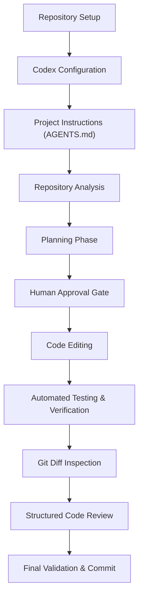

# Hands-On Lab 4: Production Workflow with Codex CLI

*Section 5 — OpenAI Codex CLI*

---

## Lab Overview

In this lab, you will configure OpenAI Codex CLI for a production-style software development workflow.

You will create a repository with persistent project instructions, configure Codex behavior, ask Codex to plan a feature before editing files, authorize controlled code changes, run automated verification, inspect the generated diff, and perform a structured code review.

The project uses a small Node.js REST API so that the workflow remains easy to understand while still demonstrating realistic engineering practices.

### Workflow Sequence



### Learning Objectives
By the end of this lab, you will be able to:
- Install and authenticate Codex CLI.
- Open a local repository with Codex.
- Configure Codex using a configuration file (`config.toml`).
- Create persistent repository instructions (`AGENTS.md`).
- Define source-code and testing standards.
- Run a planning-first workflow.
- Prevent Codex from editing files before approval.
- Allow Codex to implement a controlled feature.
- Run tests, linting, and formatting checks.
- Inspect generated code using Git.
- Perform a structured code review with Codex.
- Identify unnecessary, unsafe, or unrelated changes.
- Decide whether generated code is ready to commit.

### Estimated Completion Time
Approximately 90–120 minutes

### Prerequisites
You should have:
- Windows, macOS, Linux, or WSL
- Git
- Node.js 20 or later
- npm
- A code editor such as Visual Studio Code
- A ChatGPT account with Codex access or API credentials
- Basic familiarity with JavaScript
- Basic familiarity with Git and terminal commands

### Final Project Structure
At the end of the lab, your repository should resemble:

```text
codex-inventory-api/
│
├── .codex/
│   └── config.toml
│
├── src/
│   ├── AGENTS.md
│   ├── app.js
│   ├── inventory-service.js
│   └── server.js
│
├── test/
│   ├── AGENTS.md
│   └── app.test.js
│
├── AGENTS.md
├── eslint.config.js
├── package.json
├── package-lock.json
├── .prettierrc.json
├── .gitignore
└── README.md
```

---

## Part 1: Install Codex CLI

### Step 1: Verify Development Tools
Open a terminal and run:

```bash
git --version
node --version
npm --version
```

Recommended output resembles:
```text
git version 2.x.x
v20.x.x or later
10.x.x or later
```

### Step 2: Install Codex CLI
Choose the method appropriate for your operating system:

#### Windows PowerShell
```powershell
powershell -ExecutionPolicy ByPass -c "irm https://chatgpt.com/codex/install.ps1 | iex"
```

#### macOS or Linux
```bash
curl -fsSL https://chatgpt.com/codex/install.sh | sh
```

#### npm Installation
```bash
npm install -g @openai/codex
```

#### Homebrew Installation
```bash
brew install --cask codex
```

> [!NOTE]
> Close and reopen the terminal if the `codex` command is not immediately available.

### Step 3: Verify the Installation
Run:

```bash
codex --version
```

Record:
- **Codex CLI version**: 
- **Operating system**: 
- **Installation method**: 
- **Installation successful**: Yes / No

### Step 4: Authenticate Codex
Start Codex:

```bash
codex
```

Select:
```text
Sign in with ChatGPT
```
Complete the browser-based authentication process. Alternatively, use API-key authentication when required by your organization or instructor.

> [!WARNING]
> Never place an API key inside:
> - Source code
> - An instruction file (`AGENTS.md`)
> - A repository configuration file (`config.toml`)
> - A screenshot
> - A Git commit
> - A shared classroom document

Exit Codex after authentication.

---

## Part 2: Create the Sample Repository

### Step 5: Create the Project
Run:

```bash
mkdir codex-inventory-api
cd codex-inventory-api

git init
npm init -y
```

Install the runtime dependency:

```bash
npm install express
```

Install development dependencies:

```bash
npm install --save-dev jest supertest eslint @eslint/js prettier
```

### Step 6: Create the Folder Structure

#### macOS, Linux, or Git Bash
```bash
mkdir src test
touch src/app.js
touch src/server.js
touch src/inventory-service.js
touch test/app.test.js
touch eslint.config.js
touch .prettierrc.json
touch .gitignore
touch README.md
```

#### Windows PowerShell
```powershell
New-Item -ItemType Directory src
New-Item -ItemType Directory test
 
New-Item src\app.js
New-Item src\server.js
New-Item src\inventory-service.js
New-Item test\app.test.js
New-Item eslint.config.js
New-Item .prettierrc.json
New-Item .gitignore
New-Item README.md
```

---

## Part 3: Build the Baseline Application

### Step 7: Create the Inventory Service
Add the following code to `src/inventory-service.js`:

```javascript
const products = [
  {
    id: 1,
    name: "Mechanical Keyboard",
    quantity: 12,
  },
  {
    id: 2,
    name: "Wireless Mouse",
    quantity: 7,
  },
];
 
function getAllProducts() {
  return products;
}
 
function getProductById(id) {
  return products.find((product) => product.id === id);
}
 
function createProduct(name, quantity) {
  const product = {
    id: products.length + 1,
    name,
    quantity,
  };
 
  products.push(product);
 
  return product;
}
 
module.exports = {
  createProduct,
  getAllProducts,
  getProductById,
};
```

### Step 8: Create the Express Application
Add the following code to `src/app.js`:

```javascript
const express = require("express");
 
const {
  createProduct,
  getAllProducts,
  getProductById,
} = require("./inventory-service");
 
const app = express();
 
app.use(express.json());
 
app.get("/health", (request, response) => {
  response.status(200).json({
    status: "ok",
  });
});
 
app.get("/products", (request, response) => {
  response.status(200).json(getAllProducts());
});
 
app.get("/products/:id", (request, response) => {
  const productId = Number(request.params.id);
  const product = getProductById(productId);
 
  if (!product) {
    return response.status(404).json({
      error: "Product not found",
    });
  }
 
  return response.status(200).json(product);
});
 
app.post("/products", (request, response) => {
  const { name, quantity } = request.body;
 
  if (!name || typeof name !== "string") {
    return response.status(400).json({
      error: "A valid product name is required",
    });
  }
 
  if (!Number.isInteger(quantity) || quantity < 0) {
    return response.status(400).json({
      error: "Quantity must be a non-negative integer",
    });
  }
 
  const product = createProduct(name.trim(), quantity);
 
  return response.status(201).json(product);
});
 
module.exports = app;
```

### Step 9: Create the Server
Add this code to `src/server.js`:

```javascript
const app = require("./app");
 
const port = process.env.PORT || 3000;
 
app.listen(port, () => {
  console.log(`Inventory API listening on port ${port}`);
});
```

### Step 10: Create the Tests
Add the following code to `test/app.test.js`:

```javascript
const request = require("supertest");
 
const app = require("../src/app");
 
describe("Inventory API", () => {
  test("GET /health returns the service status", async () => {
    const response = await request(app).get("/health");
 
    expect(response.statusCode).toBe(200);
    expect(response.body).toEqual({
      status: "ok",
    });
  });
 
  test("GET /products returns all products", async () => {
    const response = await request(app).get("/products");
 
    expect(response.statusCode).toBe(200);
    expect(Array.isArray(response.body)).toBe(true);
  });
 
  test("GET /products/:id returns one product", async () => {
    const response = await request(app).get("/products/1");
 
    expect(response.statusCode).toBe(200);
    expect(response.body).toMatchObject({
      id: 1,
      name: "Mechanical Keyboard",
    });
  });
 
  test("GET /products/:id returns 404 for an unknown product", async () => {
    const response = await request(app).get("/products/999");
 
    expect(response.statusCode).toBe(404);
    expect(response.body).toEqual({
      error: "Product not found",
    });
  });
 
  test("POST /products creates a product", async () => {
    const response = await request(app).post("/products").send({
      name: "USB-C Hub",
      quantity: 5,
    });
 
    expect(response.statusCode).toBe(201);
    expect(response.body).toMatchObject({
      name: "USB-C Hub",
      quantity: 5,
    });
  });
 
  test("POST /products rejects a negative quantity", async () => {
    const response = await request(app).post("/products").send({
      name: "Monitor",
      quantity: -1,
    });
 
    expect(response.statusCode).toBe(400);
    expect(response.body).toEqual({
      error: "Quantity must be a non-negative integer",
    });
  });
});
```

---

## Part 4: Configure Project Quality Tools

### Step 11: Configure npm Scripts
Open `package.json` and replace the existing `scripts` section with:

```json
"scripts": {
  "start": "node src/server.js",
  "test": "jest --runInBand",
  "lint": "eslint .",
  "format": "prettier --write \"**/*.{js,json,md}\"",
  "format:check": "prettier --check \"**/*.{js,json,md}\"",
  "check": "npm run lint && npm run format:check && npm test"
}
```

### Step 12: Configure ESLint
Add the following to `eslint.config.js`:

```javascript
const js = require("@eslint/js");
 
module.exports = [
  js.configs.recommended,
  {
    files: ["**/*.js"],
    languageOptions: {
      ecmaVersion: 2022,
      sourceType: "commonjs",
      globals: {
        console: "readonly",
        describe: "readonly",
        expect: "readonly",
        module: "readonly",
        process: "readonly",
        require: "readonly",
        test: "readonly",
      },
    },
    rules: {
      eqeqeq: "error",
      "no-unused-vars": "error",
    },
  },
  {
    ignores: ["node_modules/**"],
  },
];
```

### Step 13: Configure Prettier
Add this to `.prettierrc.json`:

```json
{
  "semi": true,
  "singleQuote": false,
  "tabWidth": 2,
  "trailingComma": "all"
}
```

### Step 14: Create the Git Ignore File
Add this to `.gitignore`:

```gitignore
node_modules/
coverage/
.env
*.log
.codex/local*
```

### Step 15: Create the README
Add this content to `README.md`:

````markdown
# Codex Inventory API
 
A small Node.js and Express API used to demonstrate a production workflow with OpenAI Codex CLI.
 
## Install Dependencies
 
```bash
npm install
```
 
## Start the Application
 
```bash
npm start
```
 
## Run Tests
 
```bash
npm test
```
 
## Run All Quality Checks
 
```bash
npm run check
```
 
## Available Endpoints
 
- `GET /health`
- `GET /products`
- `GET /products/:id`
- `POST /products`
````

### Step 16: Verify the Baseline
Run:

```bash
npm run format
npm run check
```

Expected result:
```text
Linting passed
Formatting check passed
6 tests passed
```

### Step 17: Create the Baseline Commit
Run:

```bash
git add .
git commit -m "Create inventory API baseline"
```

Confirm:

```bash
git status
```
Expected result: `working tree clean`

> [!TIP]
> This baseline commit provides a clean checkpoint to restore if Codex makes unwanted changes.

---

## Part 5: Configure Codex CLI

Codex configuration is stored in a TOML configuration file. The available configuration keys and behavior can change between releases, so check the configuration reference for your installed version.

### Step 18: Create the Project Configuration Directory
Run:

```bash
mkdir .codex
```
*(On Windows PowerShell: `New-Item -ItemType Directory .codex`)*

Create `.codex/config.toml`.

### Step 19: Add a Conservative Project Configuration
Add the following to `.codex/config.toml`:

```toml
# Project-level Codex configuration
 
approval_policy = "on-request"
sandbox_mode = "workspace-write"
 
[history]
persistence = "save-all"
```

This configuration expresses a conservative, safe workflow:
- Codex may work inside the repository.
- Sensitive or broader actions require explicit approval.
- Session history is retained according to client configuration.

### Step 20: Inspect Codex Help
Run:

```bash
codex --help
```

Record the available options related to:
- **Configuration**:
- **Model selection**:
- **Approval policy**:
- **Sandbox**:
- **Non-interactive execution**:
- **Review**:

### Step 21: Start Codex Inside the Repository
Run:

```bash
codex
```

> [!IMPORTANT]
> Start Codex from the project root so it receives the correct repository context and instruction hierarchy.

Ask:

```text
Without modifying any files, tell me:
 
1. What repository you are in
2. What language and framework it uses
3. Which test framework it uses
4. Which commands are available
5. Whether the Git working tree is clean
```

Verify Codex’s response against the actual project files.

---

## Part 6: Build Project Instructions

Codex uses `AGENTS.md` files to provide persistent repository guidance. Instructions can be placed at the repository root and in nested directories so that more specific rules apply to particular areas of the codebase.

### Step 22: Create Root Project Instructions
Create `AGENTS.md` at the project root with:

````markdown
# Inventory API Project Instructions
 
## Project Purpose
 
This repository contains a small REST API for managing inventory products.
The API is used to demonstrate a controlled, production-style Codex CLI workflow.
 
## Technology
 
- Node.js
- Express
- CommonJS modules
- Jest
- Supertest
- ESLint
- Prettier
 
## Architecture
 
- `src/app.js` contains HTTP routes and request validation.
- `src/server.js` starts the HTTP server.
- `src/inventory-service.js` contains inventory business logic.
- `test/app.test.js` contains API-level tests.
- `.codex/config.toml` contains project Codex configuration.
 
## Coding Standards
 
- Use CommonJS syntax.
- Use two-space indentation.
- Use semicolons.
- Use descriptive variable and function names.
- Keep route handlers small.
- Place reusable inventory logic in the service module.
- Return explicit HTTP status codes.
- Return errors as JSON with an `error` property.
- Do not expose internal stack traces.
- Do not add dependencies without approval.
- Do not modify unrelated files.
 
## Testing Standards
 
- Use Jest and Supertest.
- Add tests for successful behavior.
- Add tests for validation failures.
- Add tests for missing resources.
- Verify HTTP status codes and response bodies.
- Do not remove or weaken existing tests.
- Run the complete test suite after code changes.
 
## Planning Requirement
 
Before editing files:
1. Inspect the relevant source and test files.
2. Explain the current behavior.
3. Identify the smallest safe implementation.
4. List the files that need to change.
5. Identify expected tests.
6. Identify edge cases.
7. Wait for approval before editing.
 
Do not edit files during the planning phase.
 
## Completion Requirement
 
Before declaring a task complete:
1. Run `npm run check`.
2. Run `git status`.
3. Review `git diff`.
4. Confirm no unrelated files changed.
5. List all changed files.
6. Summarize tests added or updated.
7. Report the final verification result.
 
## Git Safety
 
- Do not run `git push`.
- Do not force-push.
- Do not rewrite Git history.
- Do not run `git reset --hard`.
- Do not run `git clean`.
- Do not commit unless explicitly requested.
- Never commit secrets or environment files.
````

### Step 23: Create Source-Specific Instructions
Create `src/AGENTS.md`:

```markdown
# Source Code Instructions
 
These instructions apply to files inside `src/`.
 
## Architecture Rules
 
- Keep HTTP request and response handling in `app.js`.
- Keep server startup in `server.js`.
- Keep inventory operations in `inventory-service.js`.
- Do not put tests inside source files.
- Avoid duplicating business logic across routes.
 
## Endpoint Rules
 
Every endpoint must:
1. Validate path parameters and request bodies.
2. Return an explicit HTTP status code.
3. Return JSON.
4. Handle missing resources.
5. Avoid exposing implementation details.
6. Have corresponding API tests.
 
## Error Format
 
Return errors using:
 
```json
{
  "error": "Clear human-readable message"
}
```
 
## Update Operations
 
When updating a product:
1. Confirm that the product exists.
2. Validate the new value.
3. Return 404 for an unknown product.
4. Return 400 for invalid input.
5. Return the updated product on success.
```

### Step 24: Create Test-Specific Instructions
Create `test/AGENTS.md`:

```markdown
# Test Instructions
 
These instructions apply to files inside `test/`.
 
- Use Jest and Supertest.
- Use descriptive test names.
- Group related behavior with `describe`.
- Test successful and unsuccessful behavior.
- Verify status codes.
- Verify response bodies.
- Do not depend on test execution order.
- Do not use external services.
- Do not weaken assertions to make a test pass.
- Use exact equality for documented error responses.
```

### Step 25: Verify Instruction Loading
Exit and restart Codex from the repository root:

```bash
codex
```

Ask:

```text
Do not modify files.
 
Summarize the repository instructions that apply to:
 
1. All files
2. Files inside src
3. Files inside test
4. Planning tasks
5. Git operations
6. Completion verification
```

Check that Codex identifies root and nested instructions correctly.

---

## Part 7: Run a Repository Analysis

### Step 26: Ask Codex to Analyze the Current Application
Use this prompt:

```text
Analyze this repository without modifying any files.
 
Explain:
 
1. The application architecture
2. The current API endpoints
3. How request validation works
4. How missing products are handled
5. How tests are organized
6. Which production concerns are not implemented
```

Record:
- **Files inspected**:
- **Architecture identified accurately**:
- **Endpoints identified accurately**:
- **Validation identified accurately**:
- **Unsupported assumptions**:
- **Potential improvements**:

---

## Part 8: Run a Planning-First Workflow

The feature for this lab is:
`PATCH /products/:id/quantity`

Required behavior:
- Accept a JSON body containing `quantity`.
- Require a non-negative integer.
- Return `400` for invalid quantities.
- Return `404` when the product does not exist.
- Return `200` and the updated product on success.
- Add complete API tests.
- Do not add dependencies.

### Step 27: Submit the Planning Prompt
Inside Codex, enter:

```text
Plan the implementation of this feature without modifying any files:
 
PATCH /products/:id/quantity
 
Requirements:
 
- Accept a JSON body containing quantity.
- Quantity must be a non-negative integer.
- Return 400 for an invalid quantity.
- Return 404 when the product does not exist.
- Return 200 with the updated product on success.
- Add API tests using Jest and Supertest.
- Do not add dependencies.
- Preserve all existing behavior.
 
Your response must include:
 
1. Current behavior
2. Proposed implementation
3. Files to change
4. Tests to add
5. Edge cases
6. Risks
7. A numbered execution plan
 
Do not edit files, run formatting, or implement the feature.
Wait for my approval.
```

### Step 28: Evaluate the Plan
A strong plan should identify:
- [ ] `src/inventory-service.js` needs an update operation
- [ ] `src/app.js` needs the PATCH route
- [ ] `test/app.test.js` needs new tests
- [ ] No new dependency is required
- [ ] The path parameter should be converted to a number
- [ ] Invalid quantity values should return 400
- [ ] A missing product should return 404
- [ ] A successful update should return 200
- [ ] Existing behavior must remain unchanged
- [ ] The full quality workflow must run afterward

It should **NOT** propose:
- [ ] Replacing Express
- [ ] Adding a database
- [ ] Converting the project to TypeScript
- [ ] Introducing a new validation package
- [ ] Refactoring unrelated endpoints
- [ ] Changing the project module system

### Step 29: Request Plan Revisions
When the plan is too broad, respond:

```text
Revise the plan.
 
Keep the implementation limited to:
 
- src/inventory-service.js
- src/app.js
- test/app.test.js
 
Do not refactor existing routes.
Do not add dependencies.
Include separate tests for:
 
1. Successful update
2. Negative quantity
3. Decimal quantity
4. Missing quantity
5. Unknown product
```

Review the revised plan.

---

## Part 9: Approve and Execute Code Edits

### Step 30: Create a Feature Branch
Exit Codex temporarily or use another terminal:

```bash
git switch -c feature/update-product-quantity
```

Confirm:
```bash
git status
```
Expected result: `On branch feature/update-product-quantity, working tree clean`

### Step 31: Approve Implementation
Return to Codex and enter:

```text
The revised plan is approved.
 
Implement the feature now.
 
Requirements:
 
- Follow all repository instructions.
- Change only the approved files.
- Add all five requested tests.
- Do not add dependencies.
- Run npm run check.
- Run git status.
- Review git diff.
- Do not commit.
- Summarize every change and verification result.
```

> [!WARNING]
> Review every file-edit or command approval presented by Codex. Do not automatically approve commands you do not understand.

### Step 32: Observe the Execution Process
Record whether Codex:
- [ ] Inspected the files before editing
- [ ] Updated the service module
- [ ] Added the PATCH route
- [ ] Added tests
- [ ] Ran formatting
- [ ] Ran linting
- [ ] Ran tests
- [ ] Reviewed Git status
- [ ] Reviewed the diff
- [ ] Avoided unrelated files
- [ ] Avoided new dependencies
- [ ] Did not create a commit

---

## Part 10: Inspect the Generated Implementation

A reasonable service implementation may resemble:

```javascript
function updateProductQuantity(id, quantity) {
  const product = getProductById(id);
 
  if (!product) {
    return undefined;
  }
 
  product.quantity = quantity;
 
  return product;
}
```

The service export should include:

```javascript
module.exports = {
  createProduct,
  getAllProducts,
  getProductById,
  updateProductQuantity,
};
```

A reasonable route implementation may resemble:

```javascript
app.patch("/products/:id/quantity", (request, response) => {
  const productId = Number(request.params.id);
  const { quantity } = request.body;
 
  if (!Number.isInteger(quantity) || quantity < 0) {
    return response.status(400).json({
      error: "Quantity must be a non-negative integer",
    });
  }
 
  const product = updateProductQuantity(productId, quantity);
 
  if (!product) {
    return response.status(404).json({
      error: "Product not found",
    });
  }
 
  return response.status(200).json(product);
});
```

---

## Part 11: Manually Verify the Code

### Step 33: Run the Quality Checks Yourself
Even if Codex reports that checks passed, run:

```bash
npm run check
```

Record:
- **Lint result**:
- **Formatting result**:
- **Test result**:
- **Number of passing tests**:
- **Overall result**:

### Step 34: Inspect the Git Status
Run:

```bash
git status
```

Expected changed files:
- `src/app.js`
- `src/inventory-service.js`
- `test/app.test.js`

### Step 35: Review the Diff
Run:

```bash
git diff
```

Read every changed line and verify:
- [ ] Is the service logic placed in the correct file?
- [ ] Is the route placed in `app.js`?
- [ ] Is quantity validated before the update?
- [ ] Is zero accepted?
- [ ] Are negative values rejected?
- [ ] Are decimal values rejected?
- [ ] Is a missing quantity rejected?
- [ ] Is an unknown product handled?
- [ ] Is the response status correct?
- [ ] Is the updated product returned?
- [ ] Are existing routes unchanged?
- [ ] Were dependencies avoided?
- [ ] Are the tests meaningful?

---

## Part 12: Test the Endpoint Manually

### Step 36: Start the Application
Run:

```bash
npm start
```
The server starts on port `3000`.

### Step 37: Test a Successful Update
Using `curl`:

```bash
curl -X PATCH http://localhost:3000/products/1/quantity \
  -H "Content-Type: application/json" \
  -d '{"quantity":20}'
```

Windows PowerShell:
```powershell
Invoke-RestMethod `
  -Method Patch `
  -Uri "http://localhost:3000/products/1/quantity" `
  -ContentType "application/json" `
  -Body '{"quantity":20}'
```

Expected response:
```json
{
  "id": 1,
  "name": "Mechanical Keyboard",
  "quantity": 20
}
```

### Step 38: Test an Invalid Quantity
```bash
curl -X PATCH http://localhost:3000/products/1/quantity \
  -H "Content-Type: application/json" \
  -d '{"quantity":-2}'
```

Expected status: `400 Bad Request`
Expected response:
```json
{
  "error": "Quantity must be a non-negative integer"
}
```

### Step 39: Test an Unknown Product
```bash
curl -X PATCH http://localhost:3000/products/999/quantity \
  -H "Content-Type: application/json" \
  -d '{"quantity":4}'
```

Expected status: `404 Not Found`
Expected response:
```json
{
  "error": "Product not found"
}
```

Stop the server with `Ctrl+C`.

---

## Part 13: Ask Codex to Review Generated Code

### Step 40: Start a Review-Only Session
Start a fresh Codex session:

```bash
codex
```

Use this prompt:

```text
Review the current uncommitted changes.
 
Do not edit files.
 
Perform a production code review covering:
 
1. Functional correctness
2. Input validation
3. HTTP status codes
4. Error responses
5. Test coverage
6. Regression risk
7. Code readability
8. Architecture compliance
9. Security concerns
10. Unnecessary changes
 
Inspect git status and git diff.
Run npm run check if permitted.
 
Present findings by severity:
- Critical
- High
- Medium
- Low
 
For every finding include:
- File
- Relevant code
- Explanation
- Recommended correction
 
End with one conclusion:
- Ready to commit
- Needs changes
 
Do not modify the repository.
```

### Step 41: Evaluate the Review
Determine whether Codex:
- [ ] Identified every changed file
- [ ] Read the actual diff
- [ ] Checked project instructions
- [ ] Verified validation behavior
- [ ] Checked test coverage
- [ ] Checked for unrelated changes
- [ ] Ran the quality workflow
- [ ] Avoided editing files
- [ ] Used clear severity levels
- [ ] Gave a justified conclusion

---

## Part 14: Introduce a Review Defect

### Step 42: Intentionally Weaken Validation
Open `src/app.js`. Temporarily change:

```javascript
if (!Number.isInteger(quantity) || quantity < 0) {
```
to:
```javascript
if (quantity < 0) {
```

*(Do not update tests yet.)*

### Step 43: Ask Codex to Review Again
Use:

```text
Review the current changes again.
 
Focus specifically on whether quantity validation satisfies all documented requirements.
 
Do not modify files.
```

A strong review should identify that checking only `quantity < 0` is insufficient.

### Step 44: Request a Fix
After reviewing the finding, enter:

```text
Fix only the quantity-validation defect you identified.
 
Requirements:
 
- Quantity must be a non-negative integer.
- Preserve all other implementation behavior.
- Add or strengthen tests if necessary.
- Run npm run check.
- Review git diff.
- Do not commit.
```

Confirm that Codex restores strict validation.

---

## Part 15: Review the Tests

### Step 45: Inspect the Generated Tests
The tests should cover:
- `PATCH /products/:id/quantity`

Required scenarios:
1. Successful quantity update
2. Negative quantity
3. Decimal quantity
4. Missing quantity
5. Unknown product

Example successful test:
```javascript
test("PATCH /products/:id/quantity updates product quantity", async () => {
  const response = await request(app)
    .patch("/products/1/quantity")
    .send({
      quantity: 25,
    });
 
  expect(response.statusCode).toBe(200);
  expect(response.body).toMatchObject({
    id: 1,
    quantity: 25,
  });
});
```

Example invalid-input test:
```javascript
test("PATCH /products/:id/quantity rejects a decimal quantity", async () => {
  const response = await request(app)
    .patch("/products/1/quantity")
    .send({
      quantity: 2.5,
    });
 
  expect(response.statusCode).toBe(400);
  expect(response.body).toEqual({
    error: "Quantity must be a non-negative integer",
  });
});
```

---

## Part 16: Compare Planning-First and Direct Execution

### Step 46: Create a Comparison Branch
Commit the approved implementation first:

```bash
git add .
git commit -m "Add product quantity update endpoint"
```

Return to the default branch:

```bash
git switch main
```
*(or `git switch master`)*

Create a new comparison branch:

```bash
git switch -c experiment/direct-execution
```

### Step 47: Use a Direct Prompt
Start Codex and enter:

```text
Add a way to update product quantities.
```

> [!CAUTION]
> Do not provide acceptance criteria, status codes, validation rules, or planning instructions. Review Codex's generated code carefully.

### Step 48: Complete the Comparison Table

| Evaluation Area | Planning-First Workflow | Direct Prompt |
| :--- | :--- | :--- |
| **Scope was clear** | | |
| **Files were identified first** | | |
| **Validation was complete** | | |
| **Error behavior was defined** | | |
| **Tests were planned** | | |
| **Edge cases were considered** | | |
| **Unrelated changes were avoided** | | |
| **Human approval occurred before editing** | | |
| **Final verification was complete** | | |
| **Result was ready for review** | | |

---

## Part 17: Optional Non-Interactive Workflow

Codex CLI supports non-interactive execution through the `exec` command:

```bash
codex exec --help
```

A controlled automation command:

```bash
codex exec "
Analyze the current repository.
 
Do not modify files.
 
Report:
1. Git status
2. Changed files
3. Test command
4. Potential risks
"
```

> [!WARNING]
> Do not use broad automatic write permissions in a production repository without sandboxing, approvals, and verification.

---

## Part 18: Add a Reusable Planning Template

### Step 49: Create a Planning Template
Create `docs/codex-feature-template.md`:

```markdown
# Codex Feature Planning Template
 
## Feature
Describe the requested feature.
 
## Required Behavior
- Requirement 1
- Requirement 2
- Requirement 3
 
## Constraints
- Do not add dependencies.
- Do not modify unrelated files.
- Preserve existing behavior.
- Follow repository instructions.
 
## Required Planning Output
Before editing:
1. Explain current behavior.
2. Identify affected files.
3. Propose the smallest safe implementation.
4. List tests to add.
5. Identify edge cases.
6. Identify risks.
7. Present a numbered implementation plan.
8. Wait for approval.
 
## Required Completion Output
After implementation:
1. Run the complete quality workflow.
2. Review Git status.
3. Review the diff.
4. List changed files.
5. Report tests added.
6. Report verification results.
7. Do not commit without approval.
```

---

## Part 19: Production Review Checklist

Before accepting Codex-generated code, review the following:

### Scope
- [ ] Only necessary files changed
- [ ] No unrelated refactoring occurred
- [ ] No unexpected dependencies were added
- [ ] No generated or temporary files were committed

### Correctness
- [ ] Requirements are implemented
- [ ] Successful behavior works
- [ ] Invalid inputs are rejected
- [ ] Missing resources are handled
- [ ] Existing behavior is preserved

### Testing
- [ ] New behavior has tests
- [ ] Error behavior has tests
- [ ] Tests verify status codes
- [ ] Tests verify response bodies
- [ ] Complete test suite passes

### Security
- [ ] No secrets were added
- [ ] No stack traces are exposed
- [ ] Input is validated
- [ ] Dangerous commands were not executed
- [ ] No force push occurred

### Quality
- [ ] Linting passes
- [ ] Formatting passes
- [ ] Tests pass
- [ ] Code follows project instructions
- [ ] Diff is understandable

### Git
- [ ] Branch is correct
- [ ] Working tree is understood
- [ ] Diff was reviewed
- [ ] Commit message is meaningful
- [ ] Push requires explicit approval

---

## Part 20: Final Commit

### Step 50: Run Final Checks
Run:

```bash
npm run check
git status
git diff
```

### Step 51: Ask Codex for a Final Summary
Use:

```text
Provide a final implementation summary.
 
Do not modify files.
 
Include:
 
1. Feature implemented
2. Endpoint and method
3. Status codes
4. Validation rules
5. Files changed
6. Tests added
7. Quality-check results
8. Remaining risks
9. Whether the code is ready to commit
```

### Step 52: Commit the Approved Changes
Run:

```bash
git add src/app.js src/inventory-service.js test/app.test.js
git commit -m "Add product quantity update endpoint"
```

Confirm:

```bash
git status
```
Expected result: `working tree clean`

---

## Troubleshooting

### Codex Command Is Not Found
- Close and reopen the terminal.
- Run `codex --version`.
- Reinstall using the native installer or npm.
- Confirm the installation directory is on `PATH`.
- Check whether another command named `codex` is installed.

### Authentication Does Not Open
- Copy the displayed authentication address and open it manually in a browser.
- Confirm you are using the correct ChatGPT account.
- Check organizational restrictions.
- Use an approved API authentication method when required.

### Codex Does Not Read Project Instructions
- Confirm the root file is named exactly `AGENTS.md`.
- Confirm Codex was started from the repository root.
- Check that the instruction file is readable.
- Confirm nested instruction files are in the correct directories (`src/AGENTS.md`, `test/AGENTS.md`).
- Restart the Codex session after creating instruction files.

### Configuration Is Rejected
- Run `codex --help` and inspect current configuration documentation.
- Remove unsupported keys from `.codex/config.toml`.
- Codex CLI evolves rapidly, and older configuration examples may no longer be valid.

### Codex Edits Files During Planning
Stop the action immediately and restate:
```text
Planning only.
Do not modify files.
Do not run formatting.
Do not implement the feature.
Return a plan and wait for approval.
```
Restore unwanted changes with `git restore .`.

### Codex Changes Unrelated Files
Inspect `git diff --name-only`. Ask Codex:
```text
Explain why each changed file was necessary.
Do not make additional changes.
```
Restore unrelated files manually: `git restore path/to/file`.

### Tests Pass but the Feature Is Incorrect
Passing tests do not guarantee complete correctness. Check whether:
- Important edge cases are missing.
- Assertions are too weak.
- Tests verify only status codes.
- Mutable shared state affects test order.
- Invalid input types are untested.
- The implementation violates project instructions.

---

## Extension Challenges

### Challenge A: Add Product Deletion
Plan and implement `DELETE /products/:id`:
- Return `204` on success.
- Return `404` when the product does not exist.
- Add successful and missing-product tests.
- Use a planning-first workflow.

### Challenge B: Add Product Name Updates
Implement `PATCH /products/:id/name`:
- Name must be a non-empty string (trimmed).
- Return `400` for invalid input.
- Return `404` for an unknown product.
- Return the updated product.

### Challenge C: Add a Review Instruction File
Create a review checklist that Codex must use whenever asked to review changes (covering correctness, tests, validation, security, scope, architecture, and readiness to commit).

### Challenge D: Add TypeScript
Ask Codex to plan a migration from JavaScript to TypeScript (tsconfig, type definitions, test migration, build scripts, incremental strategy, and risk assessment).

### Challenge E: Add a Database
Ask Codex to plan replacing the in-memory array with a persistent database (schema, migrations, repository layer, test isolation, secrets, local dev, and rollback).

---

## Reflection Questions

Answer the following questions in complete sentences:

1. What is the purpose of the Codex configuration file?
2. What is the purpose of the root project instruction file?
3. How do nested instruction files improve repository control?
4. Why should Codex be started from the repository root?
5. What is the benefit of planning before editing?
6. Why should planning and execution be separate stages?
7. What made the implementation plan acceptable or unacceptable?
8. Which files did Codex correctly identify?
9. Did Codex propose any unnecessary changes?
10. How did project instructions influence the result?
11. Why should generated code be reviewed manually?
12. Why is `git diff` essential in an AI-assisted workflow?
13. What defects can tests fail to detect?
14. Why should validation tests include different data types?
15. What happened when validation was intentionally weakened?
16. Did Codex identify the validation defect?
17. How did the review-only prompt differ from the implementation prompt?
18. Why should review mode avoid editing files?
19. How did the direct prompt compare with the planning-first workflow?
20. What safeguards would be needed before using Codex in production?

---

## Lab Submission Requirements

Submit the following items:
- [ ] A screenshot showing the installed Codex CLI version.
- [ ] Evidence of successful authentication.
- [ ] The complete `codex-inventory-api` repository.
- [ ] The project Codex configuration (`.codex/config.toml`).
- [ ] The root project instructions (`AGENTS.md`).
- [ ] The source-specific instructions (`src/AGENTS.md`).
- [ ] The test-specific instructions (`test/AGENTS.md`).
- [ ] Codex’s original implementation plan.
- [ ] The revised approved plan.
- [ ] The Git diff generated by Codex.
- [ ] Evidence that all quality checks passed (`npm run check`).
- [ ] Evidence of manual endpoint testing (`curl` / `Invoke-RestMethod`).
- [ ] Codex’s review report.
- [ ] Evidence that Codex found the weakened validation.
- [ ] The planning-first versus direct-prompt comparison table.
- [ ] The completed production review checklist.
- [ ] Answers to all reflection questions.
- [ ] A 300–500 word conclusion.

---

## Lab Conclusion

In this lab, you configured OpenAI Codex CLI as part of a controlled production development workflow.

You did more than ask an AI agent to generate code. You created repository instructions, established architecture and testing rules, separated planning from execution, reviewed file changes, verified generated code, introduced a deliberate defect, and used Codex as an automated code reviewer.

The final workflow followed this structure:

$$\text{Instructions} \longrightarrow \text{Context} \longrightarrow \text{Planning} \longrightarrow \text{Human Approval} \longrightarrow \text{Implementation} \longrightarrow \text{Checks} \longrightarrow \text{Git Diff} \longrightarrow \text{Review} \longrightarrow \text{Commit}$$

The most important lesson is that **generated code should never be accepted solely because it looks correct or because tests pass**. Codex becomes significantly more reliable and production-ready when it operates inside a well-defined engineering harness rather than responding to vague, unrestricted coding prompts.
