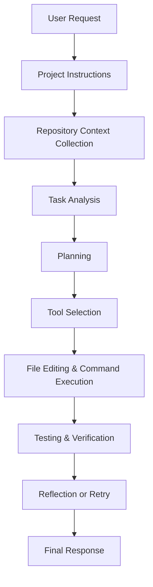
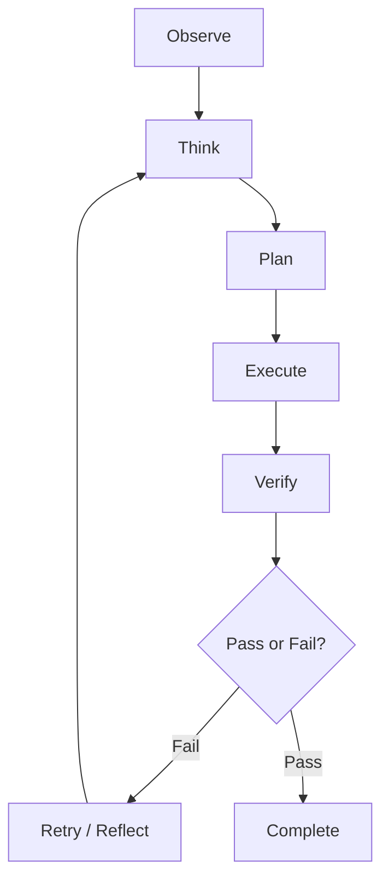

# Section 7 Walkthrough: Shared Agent Architecture

---

## Walkthrough Overview

In this walkthrough, students will map the common architecture used by modern AI coding agents and compare how **Claude Code**, **OpenAI Codex CLI**, and **Gemini CLI** implement similar agent capabilities.

### Estimated Time
Approximately 30–40 minutes

### Learning Objectives
By the end of this walkthrough, you will be able to:
- Identify the main components of an AI coding agent.
- Explain the agentic execution loop.
- Diagram how a coding request moves through an agent.
- Compare Claude Code, Codex CLI, and Gemini CLI.
- Recognize the difference between shared architecture and tool-specific features.

---

## Part 1: Diagram the Shared Agent Workflow

### Step 1: Start with the User Request
Use this example task:
> **"Add input validation to the `POST /tasks` endpoint and add tests."**

The user request becomes the starting point of the entire agent workflow.

### Step 2: Draw the Agent Workflow
Students can create the diagram using a whiteboard, PowerPoint, Canva, Excalidraw, Lucidchart, or a notebook.

Use the following architectural flow:



### Step 3: Label Each Component

#### 1. User Request
The goal, feature, bug, or engineering task provided by the user.

#### 2. Project Instructions
Persistent repository rules such as:
- Coding standards
- Architecture requirements
- Testing expectations
- Security restrictions
- Completion criteria

#### 3. Repository Context
The agent collects information from:
- Source files
- Tests
- Documentation
- Configuration files
- Git history
- Project memory

#### 4. Planning
The agent decides:
- Which files to inspect
- Which files to modify
- Which commands to run
- Which tests to add
- How to verify the result

#### 5. Tool Selection
The agent may use:
- File search
- File reading
- File editing
- Shell commands
- Git
- Testing tools
- Web access
- MCP (Model Context Protocol) servers

#### 6. Execution
The agent edits files, executes commands, and performs the requested task.

#### 7. Verification
The agent runs verification commands such as:
```bash
npm test
npm run lint
npm run build
git diff
```

#### 8. Reflection and Retry
When verification fails, the agent:
1. Reads the error message and stack trace.
2. Identifies the likely cause.
3. Revises the implementation.
4. Runs verification again.

#### 9. Final Response
The agent summarizes:
- Work completed
- Files changed
- Commands executed
- Tests performed
- Remaining risks

---

## Part 2: Map the Agentic Loop

Students should identify the repeating loop inside the architecture:



### Example Walkthrough:
- **Observe:** The `POST /tasks` endpoint accepts empty titles.
- **Think:** The endpoint requires validation before creating the task.
- **Plan:** Update `src/app.js` and add tests in `test/app.test.js`.
- **Execute:** Add title validation and new tests.
- **Verify:** Run `npm test`.
- **Retry:** Fix the implementation if a test fails.
- **Complete:** Summarize the changes and test results.

> [!IMPORTANT]
> The critical lesson is that coding agents **do not simply generate one answer**. They operate through an iterative **Observe $\to$ Think $\to$ Plan $\to$ Execute $\to$ Verify** cycle.

---

## Part 3: Compare Claude Code, Codex CLI, and Gemini CLI

Complete the following comparison table during the walkthrough:

| Architecture Area | Claude Code | Codex CLI | Gemini CLI |
| :--- | :--- | :--- | :--- |
| **Primary interface** | Terminal-based agent | Terminal-based agent | Terminal-based agent |
| **Project instructions** | Claude project instructions (`CLAUDE.md`) | Agents project instructions (`AGENTS.md`) | Gemini project context (`GEMINI.md`) |
| **Repository awareness** | Reads and searches project files | Reads and searches project files | Reads and searches project files |
| **Planning** | Planning-oriented workflows | Planning and controlled execution | Prompt-driven planning |
| **File editing** | Supported | Supported | Supported |
| **Shell commands** | Supported with permissions | Supported with approvals and sandboxing | Supported through tool execution |
| **Git operations** | Supported | Supported | Supported |
| **Testing** | Can run project test commands | Can run project test commands | Can run project test commands |
| **Memory** | Project and user memory | Repository instructions and session context | Project context and memory commands |
| **Hooks** | Strong lifecycle hook support | Workflow controlled through configuration and instructions | Extensions and tool workflows |
| **Reusable workflows** | Skills and commands | Instructions, prompts, and automation | Commands, extensions, and reusable prompts |
| **External integrations** | MCP servers | MCP and external tools | MCP and extensions |
| **Human approval** | Permission requests | Approval policies | Tool confirmation |
| **Verification** | Tests, hooks, and commands | Tests, review, and commands | Tests and tool execution |

---

## Part 4: Identify the Shared Components

Although the tools use different configuration conventions, they share the same major structural components:

### Shared Component 1: System Instructions
Each tool begins with platform-level instructions that define how the agent behaves and which capabilities it possesses.

### Shared Component 2: Project Rules
Each tool supports persistent repository guidance. Examples include:
- Use CommonJS.
- Run all tests after changes.
- Do not add dependencies.
- Do not modify unrelated files.

### Shared Component 3: Context Management
All three tools must decide:
- Which files are relevant
- How much context to load
- Which instructions apply
- What information to prioritize

### Shared Component 4: Planning
Each tool can analyze the request before changing files. A good plan identifies:
- Current behavior
- Affected files
- Proposed changes
- Required tests
- Risks
- Verification steps

### Shared Component 5: Tool Calling
All three agents can interact with development tools:
- Read file
- Search repository
- Edit file
- Run shell command
- Execute tests
- Inspect Git changes

### Shared Component 6: Permission Control
The tools place controls around potentially risky actions:
- Asking before editing files
- Asking before running shell commands
- Restricting filesystem access
- Blocking dangerous Git operations
- Executing inside a sandbox

### Shared Component 7: Verification
A reliable coding agent must verify its work instead of assuming that generated code is correct:
```bash
npm test
npm run lint
npm run build
git status
git diff
```

---

## Part 5: Highlight the Main Differences

### Claude Code
Claude Code places strong emphasis on:
- Persistent project instructions
- Hierarchical rules
- Project and user memory
- Lifecycle hooks
- Custom skills
- Permission-controlled tool use
- Model Context Protocol (MCP) integrations

### Codex CLI
Codex CLI places strong emphasis on:
- Repository-level agent instructions
- Planning-first execution
- Configurable approval policies
- Sandboxed command execution
- Precise code editing
- Automated code reviews
- Git-based verification

### Gemini CLI
Gemini CLI places strong emphasis on:
- Large-context repository understanding
- Project context and repository memory
- Flexible tool execution
- Custom extensions
- MCP integrations
- Prompt-driven workflows

> [!NOTE]
> The exact CLI implementation and terminology differ, but the underlying engineering architecture remains fundamentally consistent.

---

## Part 6: Complete a Scenario Comparison

Use this scenario task:
> **"Add `PATCH /tasks/:id/completed` to update a task's completion status."**

### Expected Workflows

#### Claude Code
```text
Read project instructions
  └── Collect relevant context
        └── Create a plan
              └── Request permission
                    └── Edit source and test files
                          └── Run hooks
                                └── Execute tests
                                      └── Summarize results
```

#### Codex CLI
```text
Read repository instructions
  └── Analyze the task
        └── Produce an implementation plan
              └── Wait for approval
                    └── Edit approved files
                          └── Run tests
                                └── Inspect Git diff
                                      └── Review generated code
```

#### Gemini CLI
```text
Load project context
  └── Inspect repository files
        └── Plan the requested feature
              └── Request tool confirmation
                    └── Edit files
                          └── Run tests
                                └── Refresh context if needed
                                      └── Summarize implementation
```

---

## Part 7: Student Activity

Students should create a one-page diagram containing:
1. The shared agent workflow.
2. The **observe $\to$ think $\to$ plan $\to$ execute $\to$ verify** loop.
3. The location of project instructions.
4. The location of human approval.
5. The location of testing and verification.
6. The retry path after verification failure.
7. One unique feature for each tool.

### Architecture Blueprint Reference

```text
                  Project Instructions
                          │
                          ▼
User Request ──► Context Collection ──► Planning
                                           │
                                           ▼
                                    Human Approval
                                           │
                                           ▼
                                     Tool Execution
                                  ┌────────┼────────┐
                                  ▼        ▼        ▼
                              File Edit  Commands  Git
                                  │        │        │
                                  └────────┼────────┘
                                           ▼
                                      Verification
                                           │
                             ┌─────────────┴─────────────┐
                             ▼                           ▼
                        [Pass]                         [Fail]
                             │                           │
                             ▼                           ▼
                       Final Response                Reflection
                                                         │
                                                         ▼
                                                       Retry ──► (Loop back)
```

---

## Discussion Questions

Answer the following questions in complete sentences:

1. Which architectural components are shared by all three tools?
2. Why do the tools use different names for similar concepts?
3. Where should human approval appear in the workflow?
4. Why should verification occur after file editing?
5. What happens when an agent skips planning?
6. What happens when an agent skips testing?
7. How does repository memory improve consistency?
8. Which tool provides the strongest support for hooks?
9. Which tool appears best suited to planning-first workflows?
10. Which tool would you choose for a large repository and why?
11. Can the same project rules be adapted for all three tools?
12. What additional components would a production agent architecture require?

---

## Walkthrough Deliverable

Students should submit:
- [ ] One shared agent architecture diagram.
- [ ] One completed comparison table.
- [ ] A short explanation of the agentic loop.
- [ ] Three similarities between the tools.
- [ ] Three differences between the tools.
- [ ] A short recommendation describing which tool they would choose for a specific development task.

---

## Walkthrough Conclusion

Claude Code, Codex CLI, and Gemini CLI differ in configuration syntax, memory persistence, permission models, and extension features, but they all share the same foundational architecture:

$$\text{Instructions} \longrightarrow \text{Context} \longrightarrow \text{Planning} \longrightarrow \text{Tool Execution} \longrightarrow \text{Verification} \longrightarrow \text{Reflection} \longrightarrow \text{Completion}$$

The core takeaway is that **the underlying coding model is only one component**. The surrounding architecture—context collection, project rules, permissions, tools, memory, verification, and retries—determines whether the agent behaves like an unpredictable code generator or a reliable, production-grade engineering system.
